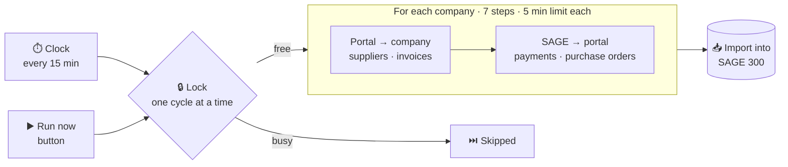

<div align="center">

```
██╗   ██╗ █████╗ ██╗  ██╗██╗██████╗     ██████╗ ███████╗██╗   ██╗
╚██╗ ██╔╝██╔══██╗██║  ██║██║██╔══██╗    ██╔══██╗██╔════╝██║   ██║
 ╚████╔╝ ███████║███████║██║██████╔╝    ██║  ██║█████╗  ██║   ██║
  ╚██╔╝  ██╔══██║██╔══██║██║██╔══██╗    ██║  ██║██╔══╝  ╚██╗ ██╔╝
   ██║   ██║  ██║██║  ██║██║██║  ██║    ██████╔╝███████╗ ╚████╔╝ 
   ╚═╝   ╚═╝  ╚═╝╚═╝  ╚═╝╚═╝╚═╝  ╚═╝    ╚═════╝ ╚══════╝  ╚═══╝  
```

### Yahir Díaz · Full-Stack Engineer

**I build the software companies run on: ERP integrations, multi-tenant SaaS and internal tools.**<br>
*AI writes code fast. I make sure it holds up in production.*

[](https://yahirdiaz-dev.vercel.app)
[](https://linkedin.com/in/yahirdev13)
[](mailto:yahir.dev13@gmail.com)


**Shipping to production since 2022** · **15+ client deliveries at Tersoft** · **Cuernavaca, Mexico 🇲🇽**

</div>

---

## 👋 About me

Full-Stack Engineer at **Tersoft** since December 2024. There I co-built and now maintain **SageConnect**, my largest system, and ship ERP work on SAGE 300 and Odoo. As an independent I build products for small businesses: a workshop ERP, a SaaS for cleaning agencies (co-developed) and websites for a clinic and a gym.

I work AI-native: **Claude Code** is my daily engine, and specs, hard rules and CI keep its output correct. I care about what happens after the deploy: fewer manual steps, fewer errors, and systems people use without asking for help.

```ts
const yahir = {
  role: "Full-Stack Engineer @ Tersoft",
  basedIn: "Cuernavaca, Mexico · UTC−6",
  stack: ["TypeScript", "React", "Next.js", "Node.js", "PostgreSQL", "SQL Server"],
  integrations: ["SAGE 300", "Odoo", "CFDI 4.0", "Stripe"],
  engine: "Claude Code + specs, tests and CI",
  shippingSince: 2022,
};
```

---

## ⭐ Featured · SageConnect, my largest system

> **Co-builder, from design to code · sole maintainer since May 2026**
>
> An always-on integration between **SAGE 300** and a **supplier portal**. Invoices, purchase orders, payments and payment complements move on their own, for several companies at once, each with its own database.



- 🔒 **One lock** shared by the scheduler and the Run now button, so two cycles never overlap. It frees itself at 14 minutes, one before the next cycle.
- ⏱️ **Every wait has a ceiling:** a portal call gives up at 30 s, a step at 5 min, the import into SAGE at 10 min.
- ♻️ **Retries without duplicates:** failed payments (every 30 min) and purchase orders (every 4 h) from the last 30 days get another try, and an order that already reached the portal is reconciled, not created twice.
- 📊 **20k lines** of JavaScript and **64 test files** on main, with **300+ of my commits** in the public repo.

`Node.js` `Express` `SQL Server` `Jest` · **[Read the case study →](https://yahirdiaz-dev.vercel.app/work/sageconnect)** · **[View the repo →](https://github.com/FReptar0/sageconnect)**

---

## 🗂️ Projects

| | Project | What it does | My role | Stack | Status |
|:-:|---|---|---|---|---|
| ⭐ | **[SageConnect](https://yahirdiaz-dev.vercel.app/work/sageconnect)** | Syncs SAGE 300 with a supplier portal for several companies, every 15 minutes | Co-builder · sole maintainer | Node.js · Express · SQL Server | 🟢 In production since 2023 |
| 🏭 | **[SageSync](https://yahirdiaz-dev.vercel.app/work/sagesync)** | Keeps a mining operation's warehouse stock in Fracttal in step with SAGE 300, three times a day | Sole developer since May 2026 | Node.js · SQL Server · Fracttal API | 🟢 In production |
| 💰 | **[Commission engine](https://yahirdiaz-dev.vercel.app/work/commission-engine)** | Odoo 18 module that turns a distributor's invoices into monthly sales commissions | Lead developer | Odoo · Python · PostgreSQL | 🟢 In production since Apr 2026 |
| 🔧 | **Pegasus — Workshop OS** | ERP/CRM for a family auto-repair shop: service-order state machine, atomic folios, row-level security | Built end to end | Next.js · TypeScript · Prisma · Supabase | 🟡 v0.4 · preparing go-live |
| 🧹 | **Cleany** | Multi-tenant SaaS for cleaning agencies: crew scheduling, Stripe billing, QR + PIN sign-in | Co-developer | React · Fastify · PostgreSQL · Stripe | 🟢 Live |
| 🏋️ | **A&D Fitness Center** | Gym website plus the coaching system behind it: routines, meal plans and progress | End to end | HTML · CSS · JavaScript | 🟢 In use |
| 🩺 | **[Clínica Biomotion](https://clinica-integral-biomotion.vercel.app)** | Website redesign for an integrated health clinic, with booking by WhatsApp | End to end | HTML · CSS · JavaScript | 🟢 Live |
| 📱 | **[Finite](https://finite-app-seven.vercel.app)** | iPhone lock-screen wallpapers with life metrics and countdowns, rendered server-side | Side project | Next.js · Satori | 🟢 Live |

---

## 🤖 How I work with AI

| 01 · Discuss | 02 · Plan | 03 · Execute | 04 · Verify |
|---|---|---|---|
| Pin down scope and gray areas with the people who will use it, before any code. | Every phase gets a plan with verification criteria. The agent does not improvise. | Claude Code implements on short branches, with atomic, traceable commits. | Types, lint and tests green, and I review every change against the plan. |

**What I don't delegate:** the data model · money and tax rules · what not to build · the final review.

---

## 💼 Experience

**Full-Stack Engineer · Tersoft** — *Dec 2024 – present*<br>
SageConnect, SageSync and the commission engine; 15+ Odoo implementations for manufacturing, distribution, retail, logistics and healthcare clients; a standard Odoo.sh deployment pipeline that cut client onboarding from weeks to days.

**Full-Stack Engineer · Independent** — *2022 – present*<br>
Products for small businesses: Pegasus, Cleany, Clínica Biomotion and A&D Fitness.

**Web Developer · Jardines de México** — *May – Sep 2023*<br>
A CFDI e-invoicing system in React, and accounting workflows moved from Excel to a web app.

🎓 **B.Eng. in Software Development & Management** — Universidad Tecnológica Emiliano Zapata (UTEZ), 2025

---

## 🛠️ Stack

**Languages**<br>


**Frontend**<br>


**Backend & APIs**<br>


**Data**<br>


**Integrations**<br>


**Quality & delivery**<br>


**AI**<br>


---

## 📫 Contact

<div align="center">

[](https://yahirdiaz-dev.vercel.app)
[](https://linkedin.com/in/yahirdev13)
[](mailto:yahir.dev13@gmail.com)

Happy to talk about integrations, SaaS or shipping with AI.

</div>

<details>
<summary><b>🇲🇽 Versión en español</b></summary>

<br>

**Yahir Díaz · Full-Stack Engineer.** Construyo el software con el que operan las empresas: integraciones con ERPs, SaaS multi-tenant y herramientas internas. *La IA escribe código rápido; yo me encargo de que funcione en producción.*

Full-Stack Engineer en **Tersoft** desde diciembre de 2024. Ahí co-construí y hoy mantengo **SageConnect**, mi sistema más grande, y entrego proyectos de ERP sobre SAGE 300 y Odoo. Por mi cuenta hago productos para negocios pequeños: un ERP para un taller, un SaaS para agencias de limpieza (co-desarrollado) y sitios para una clínica y un gimnasio. Trabajo con IA todos los días: Claude Code es mi motor, y uso specs, reglas duras y CI para que lo que produce sea correcto.

| | Proyecto | Qué hace | Mi rol | Estado |
|:-:|---|---|---|---|
| ⭐ | **[SageConnect](https://yahirdiaz-dev.vercel.app/es/work/sageconnect)** | Sincroniza SAGE 300 con un portal de proveedores para varias empresas, cada 15 minutos | Co-builder · único maintainer | 🟢 En producción desde 2023 |
| 🏭 | **[SageSync](https://yahirdiaz-dev.vercel.app/es/work/sagesync)** | Mantiene el inventario de una operación minera igual en Fracttal que en SAGE 300, tres veces al día | Desarrollador único desde mayo de 2026 | 🟢 En producción |
| 💰 | **[Motor de comisiones](https://yahirdiaz-dev.vercel.app/es/work/commission-engine)** | Módulo de Odoo 18 que convierte las facturas de una distribuidora en las comisiones mensuales de sus vendedores | Desarrollador principal | 🟢 En producción desde abril de 2026 |
| 🔧 | **Pegasus — Workshop OS** | ERP/CRM para un taller mecánico familiar: máquina de estados de órdenes, folios atómicos y row-level security | De punta a punta | 🟡 v0.4 · por salir |
| 🧹 | **Cleany** | SaaS multi-tenant para agencias de limpieza: programación de cuadrillas, cobro con Stripe y acceso con QR + PIN | Co-desarrollador | 🟢 En vivo |
| 🏋️ | **A&D Fitness Center** | Sitio de un gimnasio y el sistema de entrenamiento detrás: rutinas, dietas y progreso | De punta a punta | 🟢 En uso |
| 🩺 | **[Clínica Biomotion](https://clinica-integral-biomotion.vercel.app)** | Rediseño del sitio de una clínica integral, con citas por WhatsApp | De punta a punta | 🟢 En vivo |
| 📱 | **[Finite](https://finite-app-seven.vercel.app)** | Fondos de pantalla para iPhone con métricas de vida y cuentas regresivas | Proyecto personal | 🟢 En vivo |

**Cómo trabajo con IA:** discutir → planear → ejecutar → verificar, una fase a la vez. El modelo de datos, las reglas de dinero, lo que no se construye y la revisión final son míos.

**Portafolio en español:** [yahirdiaz-dev.vercel.app/es](https://yahirdiaz-dev.vercel.app/es)

</details>
